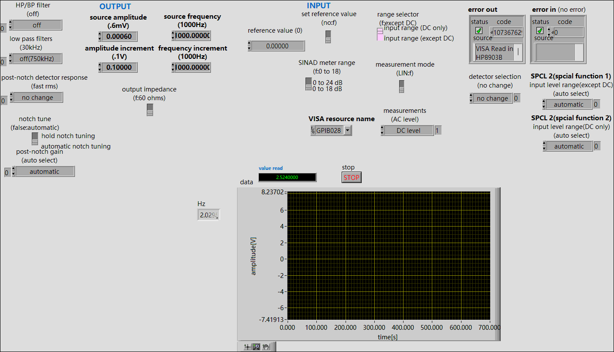
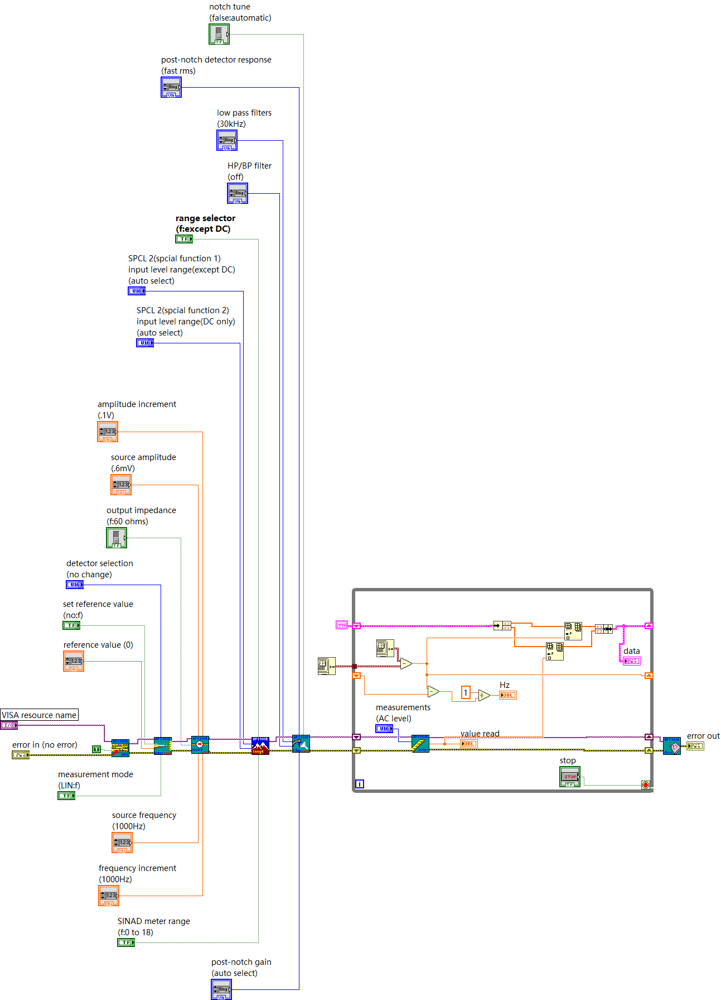

# HP 8903B Audio Analyzer Control

LabVIEW virtual instruments and visual documentation from Qiaoyu Wan’s undergraduate thesis project on remote control of an HP 8903B audio analyzer.

The project connects instrument configuration, measurement readout and a time-based display through a VISA/GPIB workflow. This repository preserves the supplied VI files and makes the graphical implementation inspectable without LabVIEW.

## Interface and implementation

The archived front panel exposes source amplitude and frequency, filter settings, input ranges, measurement selection, numerical readout and a time/amplitude graph. **This particular screenshot contains a VISA Read error and is an interface record, not evidence of a successful measurement run.**

The supplied block-diagram image shows an initialize → configure → repeated measurement → close workflow, an error wire, a stop control, timing calculations and graph data accumulation. The screenshot and VI revisions are preserved separately; their exact revision correspondence has not been established.

## Repository layout

- `labview/`: supplied project VIs, keeping their original names and relative layout.
- `labview/new/`: alternative VI revisions from the original `new` folder; not designated a validated release.
- `labview/加上时间/`: timing-related variants from the original folder.
- `docs/images/`: original front-panel and block-diagram screenshots.
- `docs/source-manifest.json`: source-relative filenames and SHA-256 checksums of copied VIs.
- `docs/SETUP.md`: hardware/software requirements and reproduction checklist.

## Scope and dependencies

This is an instrument-control project, not a replacement instrument driver. The VIs reference the external `HP8903B.LLB` instrument-driver library (including Initialize, Configure and Measure VIs). That third-party library and the separate NI DAQmx example tree are not redistributed here.

The archive supports discussion of LabVIEW graphical programming, VISA/GPIB instrument integration, configuration controls and measurement/display flow. It does not establish measurement accuracy, throughput, a verified frequency range or a quantified efficiency gain. Original filenames containing frequency values are not treated as validated specifications.

## Verification status

The files and graphical evidence were inspected and copy integrity checked. No hardware-connected LabVIEW execution was performed during repository preparation. Dependency resolution and actual measurements must be tested on a compatible instrument setup before claiming reproducibility.

## Attribution

Thesis project archive supplied by Qiaoyu Wan. Existing instrument drivers and NI examples retain their respective authorship. This repository makes no claim that external driver implementations were written from scratch. No blanket open-source license is applied to third-party materials.
